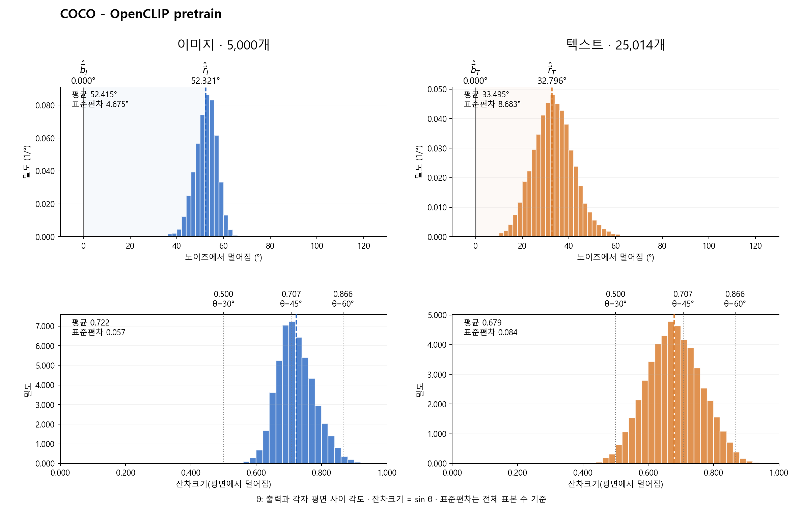
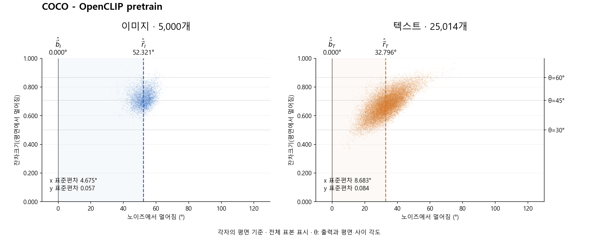
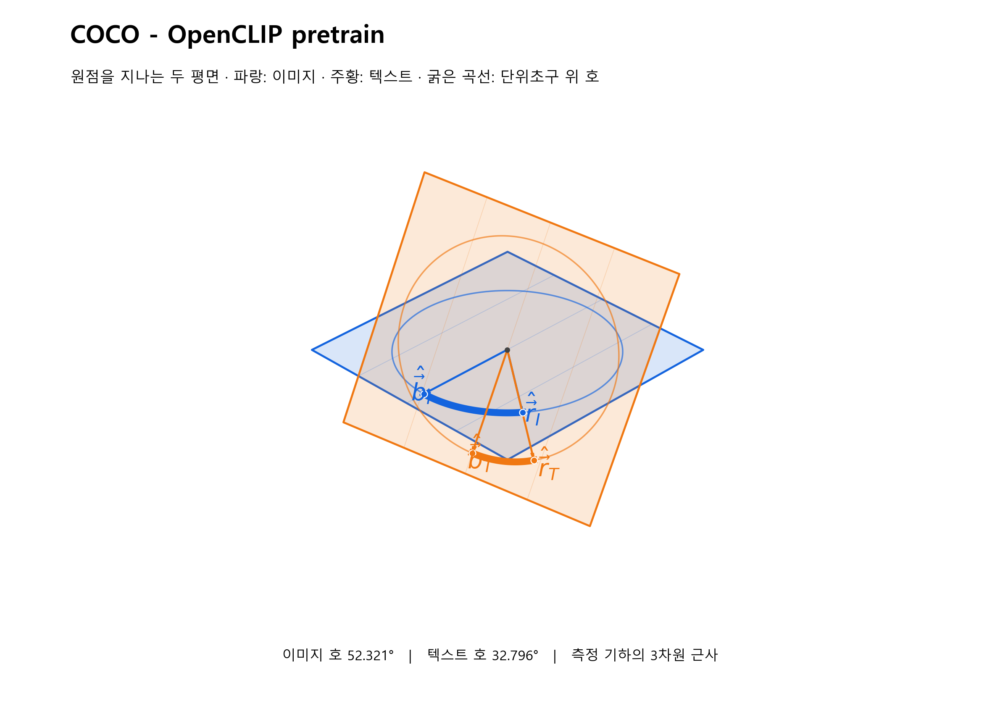

# COCO CLIP 분해 결과

## 모델과 자료 — COCO - OpenCLIP pretrain

- 이미지 인코더: **CLIP ViT-B/32**, 모델 설정 `ViT-B-32-quickgelu`.
- 텍스트 인코더: **CLIP text Transformer**, 같은 CLIP 체크포인트의 텍스트 인코더.
- 캐시의 `settings.encoder`와 `code/utils/encoders.py`의 `ClipEncoder`를 기준으로 기록했다.
- 각 인코더의 512차원 출력을 단위벡터로 정규화했다.
- COCO 캐시 전체 이미지 5,000개, 캡션 25,014개.
- 이미지 노이즈: RGB 각 픽셀을 [0,1) 균등분포에서 생성한 224×224 이미지 1,000개. seed 0, SeedSequence([0,1101]).
- 텍스트 노이즈: Random token 25,014개, seed 0. COCO 캡션 순서대로 각 캡션의 잘림 처리 후 본문 token 수와 같은 길이의 노이즈를 하나씩 생성하여 길이 분포를 정확히 맞췄다. SOT·EOT·padding을 유지하고 본문에서는 해당 ID를 제외했다. 출력별 L2 정규화 후 평균 방향을 추정한다. 캡션과 생성 노이즈의 평균 길이는 모두 11.534 token이다. 생성 token ID와 길이, 단위 출력을 `cache/clip/coco/random_token_noise.npz`에 저장한다.
- 입력 캐시: `cache/clip/coco/image.npz`, `text.npz`, `noise.npz`.
- 이미지와 텍스트는 각각 전체 참조 표본에서 자기 평균·노이즈 방향과 평면을 추정한다.
- 표준편차의 분모는 전체 표본 수이며 수치는 소수점 셋째 자리까지 표시한다.
- 체크포인트 SHA-256: `e6d1bd7789aa45192b3bf90570a789b478bae1b74ebcce7eddd908e83a2b7c31`.

## 분해와 그림의 좌표

$$\vec u=\alpha\hat{\vec r}+\beta\hat{\vec b}+\vec v,\qquad\vec v^\top\hat{\vec r}=\vec v^\top\hat{\vec b}=0.$$

$$\alpha=\frac{\vec u^\top\hat{\vec r}-\hat\gamma\vec u^\top\hat{\vec b}}{1-\hat\gamma^2},\qquad\beta=\frac{\vec u^\top\hat{\vec b}-\hat\gamma\vec u^\top\hat{\vec r}}{1-\hat\gamma^2}.$$

고정한 추정 기준에 조건부로 개별 좌표와 잔차를 계산한다. 아래첨자는 이미지 I, 텍스트 T만 사용한다.

- x축 **노이즈에서 멀어짐 (°)**: 평면 안의 방향 각도 $s$.
$$s=\operatorname{atan2}\!\left(\frac{\vec u^\top\hat{\vec r}-\hat\gamma\vec u^\top\hat{\vec b}}{\sqrt{1-\hat\gamma^2}},\ \vec u^\top\hat{\vec b}\right).$$

atan2 결과를 도로 변환한다. 노이즈 방향이 0°, 평균 방향이 세로 점선이다. 평균 방향을 넘어간 위치도 유지한다.
- y축 **잔차크기(평면에서 멀어짐)**: $\|\vec v\|=\|\vec u-\hat Q\vec u\|$.
- 그림의 보조 눈금 $\theta$는 출력과 자기 평면 사이 각도로, $\|\vec v\|=\sin\theta$이다. $\hat\theta$는 두 추정 방향 사이 각도이다.

## 표 1. 인코더별 추정량

| 추정모수(의미) | 추정량 | 이미지 | 텍스트 |
|---|---|---:|---:|
| 데이터 집중도 | $\hat R=\|\hat{\vec\mu}\|$ | 0.684 | 0.716 |
| 노이즈 집중도 | $\|\hat{\bar{\vec u}}\|$ | 0.994 | 0.841 |
| 평균–노이즈 방향 코사인 | $\hat\gamma=\hat{\vec r}^\top\hat{\vec b}$ | 0.611 | 0.841 |
| 평균–노이즈 방향 각도 (°) | $\hat\theta$ | 52.321 | 32.796 |
| 단위초구 위 호의 길이 (rad) | $\hat\theta$ | 0.913 | 0.572 |
| Conformity–imageness 각도 (°) | $\arccos(\hat{\vec r}^\top\hat{\vec m})$ | 63.839 | 73.602 |
| 평균 방향 좌표의 평균 | $\frac1N\sum\alpha$ | 0.684 | 0.716 |
| 평균 방향 좌표의 표준편차 | $\alpha$의 표준편차 | 0.069 | 0.126 |
| 노이즈 방향 좌표의 평균 | $\frac1N\sum\beta$ | 0.000 | 0.000 |
| 노이즈 방향 좌표의 표준편차 | $\beta$의 표준편차 | 0.069 | 0.194 |
| 평균 방향 정렬의 평균 | $\frac1N\sum\vec u^\top\hat{\vec r}$ | 0.684 | 0.716 |
| 노이즈 방향 코사인의 평균 | $\frac1N\sum\vec u^\top\hat{\vec b}$ | 0.418 | 0.602 |
| Conformity 평균 | $\frac1N\sum C$ | 0.468 | 0.513 |
| Imageness 평균 | $\frac1N\sum h$ | 0.842 | 0.858 |
| Imageness 표준편차 | $h$의 표준편차 | 0.059 | 0.155 |
| 개별 잔차크기의 평균 | $\hat L(\vec v)$ | 0.722 | 0.679 |
| 개별 잔차크기의 표준편차 | $\|\vec v\|$의 표준편차 | 0.057 | 0.084 |
| 평균 잔차의 크기 | $\hat R(\vec v)$ | 0.000 | 0.000 |
| 잔차 크기로 가중한 방향 집중도 | $\hat\kappa$ | 0.000 | 0.000 |
| 잔차 크기로 가중한 방향 분산 | $\hat V$ | 1.000 | 1.000 |
| 잔차 전체의 분산 | $\operatorname{tr}(\hat\Sigma)$ | 0.525 | 0.469 |
| 노이즈에서 멀어짐 평균 (°) | $s$의 평균 | 52.415 | 33.495 |
| 노이즈에서 멀어짐 표준편차 (°) | $s$의 표준편차 | 4.675 | 8.683 |
| 노이즈에서 멀어짐과 잔차크기 상관 | Pearson 상관계수 | 0.226 | 0.708 |

전체 평균 방향을 추정한 표본과 잔차 집계 표본이 같으므로 평균 잔차는 수치 오차 수준에서 0이다. 따라서 가중 방향 집중도는 0, 가중 방향 분산은 1이다.

## 표 2. 두 인코더 사이 방향 관계

| 추정모수(의미) | 추정량 | 이미지 | 텍스트 | 각도 (°) |
|---|---|---|---|---:|
| 평균–평균 | $\arccos(\hat{\vec r}_I^\top\hat{\vec r}_T)$ | $\hat{\vec r}_I$ | $\hat{\vec r}_T$ | 72.080 |
| 평균–노이즈 | $\arccos(\hat{\vec r}_I^\top\hat{\vec b}_T)$ | $\hat{\vec r}_I$ | $\hat{\vec b}_T$ | 71.803 |
| 평균–Imageness | $\arccos(\hat{\vec r}_I^\top\hat{\vec m}_T)$ | $\hat{\vec r}_I$ | $\hat{\vec m}_T$ | 90.466 |
| 노이즈–평균 | $\arccos(\hat{\vec b}_I^\top\hat{\vec r}_T)$ | $\hat{\vec b}_I$ | $\hat{\vec r}_T$ | 76.050 |
| 노이즈–노이즈 | $\arccos(\hat{\vec b}_I^\top\hat{\vec b}_T)$ | $\hat{\vec b}_I$ | $\hat{\vec b}_T$ | 74.356 |
| 노이즈–Imageness | $\arccos(\hat{\vec b}_I^\top\hat{\vec m}_T)$ | $\hat{\vec b}_I$ | $\hat{\vec m}_T$ | 92.901 |
| Imageness–평균 | $\arccos(\hat{\vec m}_I^\top\hat{\vec r}_T)$ | $\hat{\vec m}_I$ | $\hat{\vec r}_T$ | 85.667 |
| Imageness–노이즈 | $\arccos(\hat{\vec m}_I^\top\hat{\vec b}_T)$ | $\hat{\vec m}_I$ | $\hat{\vec b}_T$ | 87.229 |
| Imageness–Imageness | $\arccos(\hat{\vec m}_I^\top\hat{\vec m}_T)$ | $\hat{\vec m}_I$ | $\hat{\vec m}_T$ | 87.238 |

두 평면의 비교에는 다음 행렬식 기반 코사인 정의를 사용한다.

$$\frac{|(\hat{\vec r}_I^\top\hat{\vec r}_T)(\hat{\vec b}_I^\top\hat{\vec b}_T)-(\hat{\vec r}_I^\top\hat{\vec b}_T)(\hat{\vec b}_I^\top\hat{\vec r}_T)|}{\sqrt{1-\hat\gamma_I^2}\sqrt{1-\hat\gamma_T^2}}.$$

값은 **0.018**, 이 정의에 대응하는 각도는 **88.973°**이다.

## 그림 1. 2×2 히스토그램

## 그림 2. 1×2 산점도

## 그림 3. 두 평면과 단위초구 위 호

각 인코더의 평균–노이즈 각도를 보존하고, 네 방향의 인코더 간 내적 오차를 최소화하여 3차원에 배치했다. 표 2는 원래 512차원의 측정값이며 그림 3은 시각화를 위한 근사이다.

인코더 간 코사인 근사의 RMSE: 0.118.

## 분포의 의미

이미지의 노이즈에서 멀어짐과 잔차크기 상관은 0.226, 텍스트는 0.708이다. 두 인코더 모두 노이즈에서 멀어질수록 잔차크기가 커지는 경향이며, 텍스트에서 더 뚜렷하다.

이미지는 평균·노이즈 두 방향 밖에 남는 개별 이미지의 성분을, 텍스트는 두 방향 밖에 남는 개별 캡션의 성분을 보여준다. 물체·장면·구도와 문장의 내용·표현 차이가 가능한 원인이며, 원인 구분은 해당 이미지와 캡션을 연결하여 확인한다.

특히 텍스트에서 노이즈 방향에 가까운 캡션은 평균–노이즈 평면 밖 성분도 상대적으로 작다. 노이즈에서 멀어질수록 두 기준 방향으로 설명한 뒤 남는 캡션별 성분이 커진다. 이는 관측된 표본 간 관계이며, 노이즈점으로 수렴한다는 판단에는 노이즈에서 멀어짐과 잔차크기가 함께 0으로 작아지는 과정의 확인이 필요하다.

같은 산점도 위치의 출력도 서로 다른 잔차 방향을 가질 수 있다. 잔차크기는 평균·노이즈 평면으로 설명한 뒤 남는 성분의 양을 나타낸다.

$$\operatorname{tr}(\hat\Sigma)=\frac1N\sum\|\vec v\|^2-\left\|\frac1N\sum\vec v\right\|^2.$$

잔차크기의 표준편차는 이미지 0.057, 텍스트 0.084이며, 잔차 전체의 분산은 각각 0.525, 0.469이다. 전자는 길이의 변동을, 후자는 잔차 벡터 전체의 퍼짐을 나타낸다. 텍스트는 잔차 길이의 변동이 더 크고, 이미지는 잔차 전체의 분산이 더 크다.

## 재현

`C:/Users/USER/anaconda3/envs/torch_ev/python.exe D:/Oblique/code/analysis/COCO/decomposition.py`

기존 이미지·캡션 캐시를 읽고 Random token 출력을 메모리에서 생성하여 figure1.png, figure2.png, figure3.png, decompostion.md를 갱신한다. noise.npz의 이미지 노이즈를 사용하며 텍스트 노이즈는 이 코드에서 새로 생성한다.
