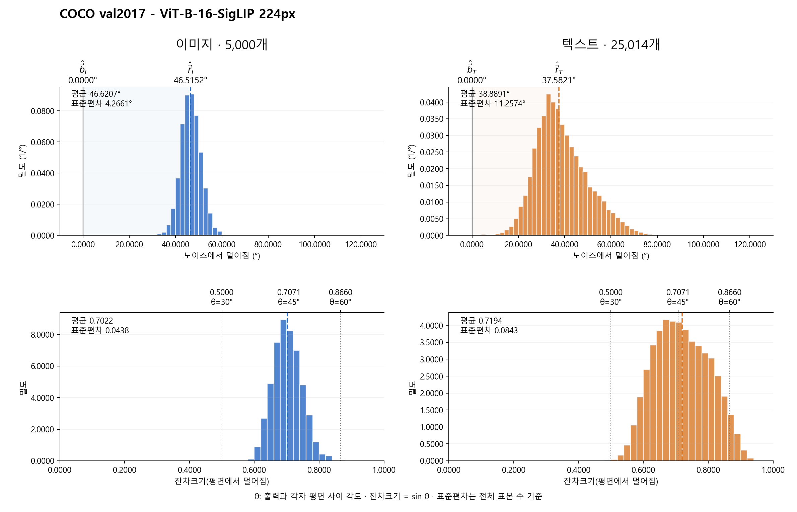
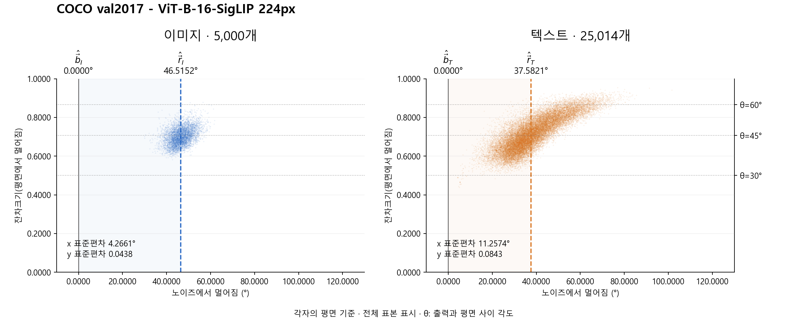
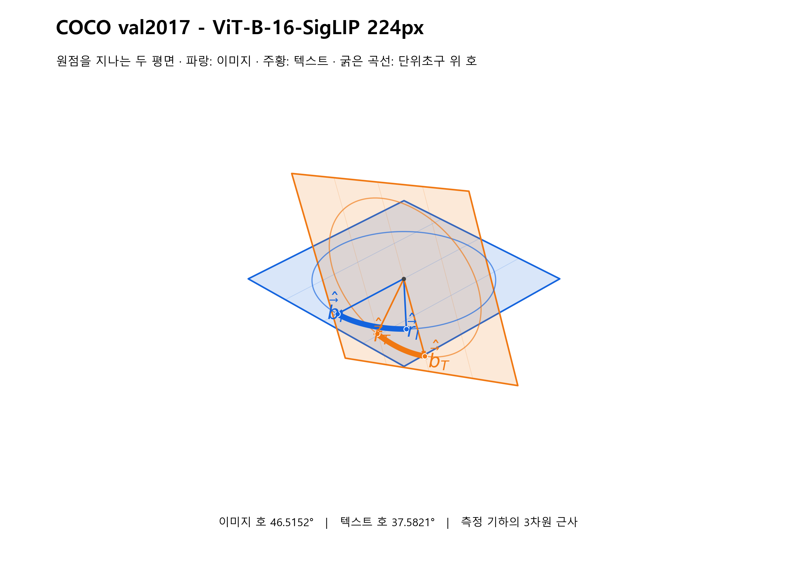

# COCO val2017 - ViT-B-16-SigLIP 224px 분해 결과

## 모델과 자료

- 모델: ViT-B-16-SigLIP, WebLI SigLIP, 224px, 출력 768차원.
- 표본: COCO val2017, 이미지 출력 5,000개, 텍스트 출력 25,014개. 각 출력을 단위 정규화한다.
- 이미지 노이즈: 224×224 RGB 균등분포 [0,1) 1,000개, SeedSequence([0,1101]). 모델의 이미지 정규화를 적용한다.
- 텍스트 노이즈: 본문 token 수를 각각 맞춘 random token 25,014개, seed 0. 특수 token 위치와 padding을 유지하고 특수 ID를 제외한 어휘에서 추출한다. 평균 본문 길이 12.7371.
- CIFAR는 클래스 프롬프트 각각 한 개, A-OKVQA는 질문–보기 4개씩, COCO는 전체 캡션을 사용한다. A-OKVQA 이미지 출력은 질문별 표본이므로 같은 영상이 반복될 수 있다.
- 각 모달리티의 전체 표본으로 평균 방향을, 같은 인코더의 입력 노이즈 출력으로 노이즈 방향을 구한다. 기존 COCO와 같은 비직교 3항 분해를 적용한다.
- 소수점 네 자리, 표준편차는 전체 표본 수 기준. 그림은 전체 표본을 표시한다.
- 데이터 캐시: `cache\clip\coco_val_siglip_vitb16/embeddings.npz`. 이미지 노이즈: `cache\clip\decomposition_noise_vit-b-16-siglip\image_noise.npy`. 텍스트 노이즈: `cache\clip\coco_val_siglip_vitb16\random_token_noise.npy`.
- 체크포인트 SHA-256: `a604948f7bb8788e4652f6ec7b7bd792dd63f55f849fa3e5fbf8b462353b9934`.

## 분해와 그림의 좌표

$$\vec u=\alpha\hat{\vec r}+\beta\hat{\vec b}+\vec v,\qquad\vec v^\top\hat{\vec r}=\vec v^\top\hat{\vec b}=0.$$

$$\alpha=\frac{\vec u^\top\hat{\vec r}-\hat\gamma\vec u^\top\hat{\vec b}}{1-\hat\gamma^2},\qquad\beta=\frac{\vec u^\top\hat{\vec b}-\hat\gamma\vec u^\top\hat{\vec r}}{1-\hat\gamma^2}.$$

고정한 추정 기준에 조건부로 개별 좌표와 잔차를 계산한다. 아래첨자는 이미지 I, 텍스트 T만 사용한다.

- x축 **노이즈에서 멀어짐 (°)**: 평면 안의 방향 각도 $s$.
$$s=\operatorname{atan2}\!\left(\frac{\vec u^\top\hat{\vec r}-\hat\gamma\vec u^\top\hat{\vec b}}{\sqrt{1-\hat\gamma^2}},\ \vec u^\top\hat{\vec b}\right).$$

atan2 결과를 도로 변환한다. 노이즈 방향이 0°, 평균 방향이 세로 점선이다. 평균 방향을 넘어간 위치도 유지한다.
- y축 **잔차크기(평면에서 멀어짐)**: $\|\vec v\|=\|\vec u-\hat Q\vec u\|$.
- 그림의 보조 눈금 $\theta$는 출력과 자기 평면 사이 각도로, $\|\vec v\|=\sin\theta$이다. $\hat\theta$는 두 추정 방향 사이 각도이다.

## 표 1. 인코더별 추정량

| 추정모수(의미) | 추정량 | 이미지 | 텍스트 |
|---|---|---:|---:|
| 데이터 집중도 | $\hat R=\|\hat{\vec\mu}\|$ | 0.7073 | 0.6712 |
| 노이즈 집중도 | $\|\hat{\bar{\vec u}}\|$ | 0.9953 | 0.8003 |
| 평균–노이즈 방향 코사인 | $\hat\gamma=\hat{\vec r}^\top\hat{\vec b}$ | 0.6882 | 0.7925 |
| 평균–노이즈 방향 각도 (°) | $\hat\theta$ | 46.5152 | 37.5821 |
| 단위초구 위 호의 길이 (rad) | $\hat\theta$ | 0.8118 | 0.6559 |
| Conformity–imageness 각도 (°) | $\arccos(\hat{\vec r}^\top\hat{\vec m})$ | 66.7424 | 71.2089 |
| 평균 방향 좌표의 평균 | $\frac1N\sum\alpha$ | 0.7073 | 0.6712 |
| 평균 방향 좌표의 표준편차 | $\alpha$의 표준편차 | 0.0527 | 0.1027 |
| 노이즈 방향 좌표의 평균 | $\frac1N\sum\beta$ | 0.0000 | 0.0000 |
| 노이즈 방향 좌표의 표준편차 | $\beta$의 표준편차 | 0.0718 | 0.1999 |
| 평균 방향 정렬의 평균 | $\frac1N\sum\vec u^\top\hat{\vec r}$ | 0.7073 | 0.6712 |
| 노이즈 방향 코사인의 평균 | $\frac1N\sum\vec u^\top\hat{\vec b}$ | 0.4867 | 0.5319 |
| Conformity 평균 | $\frac1N\sum C$ | 0.5003 | 0.4505 |
| Imageness 평균 | $\frac1N\sum h$ | 0.8537 | 0.8356 |
| Imageness 표준편차 | $h$의 표준편차 | 0.0561 | 0.1440 |
| 개별 잔차크기의 평균 | $\hat L(\vec v)$ | 0.7022 | 0.7194 |
| 개별 잔차크기의 표준편차 | $\|\vec v\|$의 표준편차 | 0.0438 | 0.0843 |
| 평균 잔차의 크기 | $\hat R(\vec v)$ | 0.0000 | 0.0000 |
| 잔차 크기로 가중한 방향 집중도 | $\hat\kappa$ | 0.0000 | 0.0000 |
| 잔차 크기로 가중한 방향 분산 | $\hat V$ | 1.0000 | 1.0000 |
| 잔차 전체의 분산 | $\operatorname{tr}(\hat\Sigma)$ | 0.4950 | 0.5247 |
| 노이즈에서 멀어짐 평균 (°) | $s$의 평균 | 46.6207 | 38.8891 |
| 노이즈에서 멀어짐 표준편차 (°) | $s$의 표준편차 | 4.2661 | 11.2574 |
| 노이즈에서 멀어짐과 잔차크기 상관 | Pearson 상관계수 | 0.3949 | 0.8136 |

전체 평균 방향을 추정한 표본과 잔차 집계 표본이 같으므로 평균 잔차는 수치 오차 수준에서 0이다. 따라서 가중 방향 집중도는 0, 가중 방향 분산은 1이다.

## 표 2. 두 인코더 사이 방향 관계

| 추정모수(의미) | 추정량 | 이미지 | 텍스트 | 각도 (°) |
|---|---|---|---|---:|
| 평균–평균 | $\arccos(\hat{\vec r}_I^\top\hat{\vec r}_T)$ | $\hat{\vec r}_I$ | $\hat{\vec r}_T$ | 99.2070 |
| 평균–노이즈 | $\arccos(\hat{\vec r}_I^\top\hat{\vec b}_T)$ | $\hat{\vec r}_I$ | $\hat{\vec b}_T$ | 93.1356 |
| 평균–Imageness | $\arccos(\hat{\vec r}_I^\top\hat{\vec m}_T)$ | $\hat{\vec r}_I$ | $\hat{\vec m}_T$ | 99.4073 |
| 노이즈–평균 | $\arccos(\hat{\vec b}_I^\top\hat{\vec r}_T)$ | $\hat{\vec b}_I$ | $\hat{\vec r}_T$ | 96.1551 |
| 노이즈–노이즈 | $\arccos(\hat{\vec b}_I^\top\hat{\vec b}_T)$ | $\hat{\vec b}_I$ | $\hat{\vec b}_T$ | 90.5893 |
| 노이즈–Imageness | $\arccos(\hat{\vec b}_I^\top\hat{\vec m}_T)$ | $\hat{\vec b}_I$ | $\hat{\vec m}_T$ | 98.6539 |
| Imageness–평균 | $\arccos(\hat{\vec m}_I^\top\hat{\vec r}_T)$ | $\hat{\vec m}_I$ | $\hat{\vec r}_T$ | 93.8322 |
| Imageness–노이즈 | $\arccos(\hat{\vec m}_I^\top\hat{\vec b}_T)$ | $\hat{\vec m}_I$ | $\hat{\vec b}_T$ | 93.2240 |
| Imageness–Imageness | $\arccos(\hat{\vec m}_I^\top\hat{\vec m}_T)$ | $\hat{\vec m}_I$ | $\hat{\vec m}_T$ | 90.9422 |

두 평면의 비교에는 다음 행렬식 기반 코사인 정의를 사용한다.

$$\frac{|(\hat{\vec r}_I^\top\hat{\vec r}_T)(\hat{\vec b}_I^\top\hat{\vec b}_T)-(\hat{\vec r}_I^\top\hat{\vec b}_T)(\hat{\vec b}_I^\top\hat{\vec r}_T)|}{\sqrt{1-\hat\gamma_I^2}\sqrt{1-\hat\gamma_T^2}}.$$

값은 **0.0095**, 이 정의에 대응하는 각도는 **89.4537°**이다.

## 그림 1. 2×2 히스토그램

## 그림 2. 1×2 산점도

## 그림 3. 두 평면과 단위초구 위 호

각 인코더의 평균–노이즈 각도를 보존하고, 네 방향의 인코더 간 내적 오차를 최소화하여 3차원에 배치했다. 표 2는 원래 임베딩 차원의 측정값이며 그림 3은 시각화를 위한 근사이다.

인코더 간 코사인 근사의 RMSE: 0.1223.

## 분포의 의미

이미지의 노이즈에서 멀어짐과 잔차크기 상관은 0.3949, 텍스트는 0.8136이다.

같은 산점도 위치의 출력도 서로 다른 잔차 방향을 가질 수 있다. 잔차크기는 평균·노이즈 평면으로 설명한 뒤 남는 성분의 양을 나타낸다.

$$\operatorname{tr}(\hat\Sigma)=\frac1N\sum\|\vec v\|^2-\left\|\frac1N\sum\vec v\right\|^2.$$

잔차크기의 표준편차는 이미지 0.0438, 텍스트 0.0843이며, 잔차 전체의 분산은 각각 0.4950, 0.5247이다. 전자는 길이의 변동을, 후자는 잔차 벡터 전체의 퍼짐을 나타낸다.

## 재현

`python D:\Oblique\code\analysis\COCO_SigLIP_VIT-B_16\decomposition.py`

같은 데이터의 평균·입력 노이즈 방향으로 3항을 분해하고 표 2개와 그림 3개를 생성한다. 입력 노이즈 캐시는 cache/ 아래에 저장한다.
