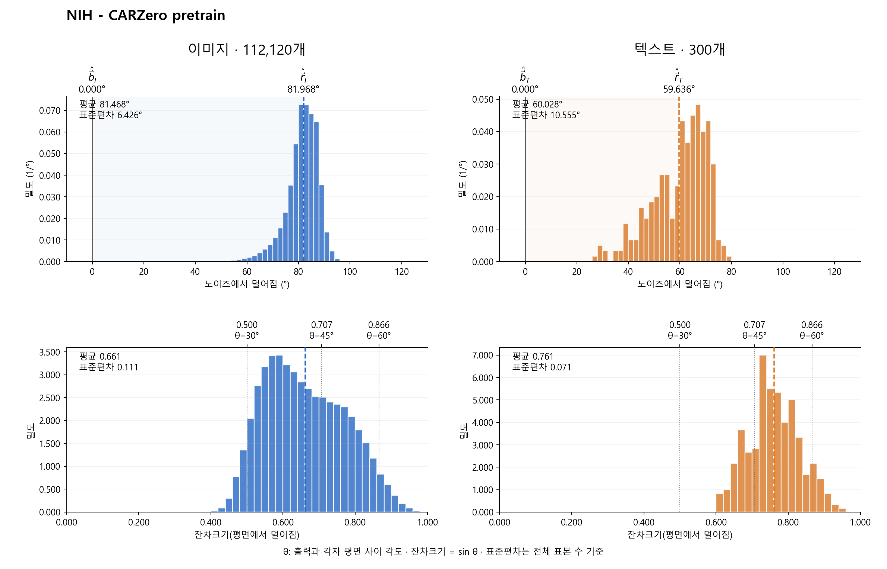
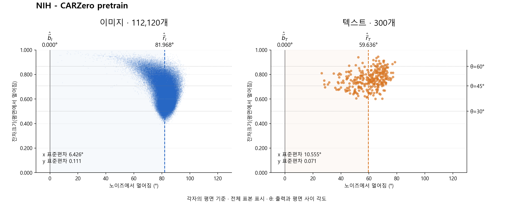
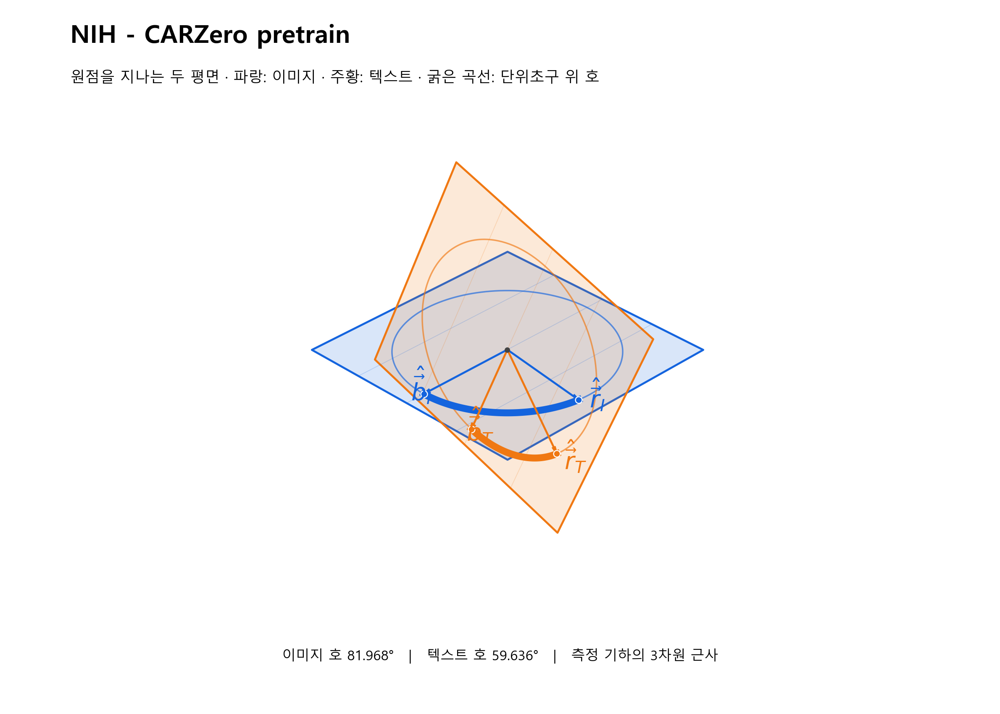

# NIH CARZero 분해 결과

## 모델과 자료 — NIH - CARZero pretrain

- 이미지 인코더: **ViT-B/16**, 체크포인트 설정 `vit_b_16`, 구현 `ImageEncoder`.
- 텍스트 인코더: **Laihaoran/BioClinicalMPBERT**, 구현 `BertEncoder`.
- 두 이름은 `ckpt/best_model.ckpt`의 `hyper_parameters.model`에서 확인했다.
- Fusion 전 각 인코더의 768차원 전역 출력을 단위벡터로 정규화했다.
- NIH 전체 이미지 112,120개, No Finding 포함 15항목 × 10템플릿 × 긍정·부정 = 300문장.
- 이미지 노이즈: 그레이스케일 가우시안 1,000개, 평균 0.500, 표준편차 0.200, [0,1] 제한, uint8 내림 후 RGB 동일 복제, seed 0.
- 텍스트 노이즈: 기존 문자 500개 + 단어 500개.
- 입력 캐시: `cache/carzero/nih/all_image.npz`, `text.npz`, `noise.npz`.
- 이미지와 텍스트는 각각 전체 참조 표본에서 자기 평균·노이즈 방향과 평면을 추정한다.
- 표준편차의 분모는 전체 표본 수이며 수치는 소수점 셋째 자리까지 표시한다.
- 체크포인트 SHA-256: `60811002cab1c8858950ed47355694d8bdbf8ba0e304fd3970fb40ca786f511d`.

## 분해와 그림의 좌표

$$\vec u=\alpha\hat{\vec r}+\beta\hat{\vec b}+\vec v,\qquad\vec v^\top\hat{\vec r}=\vec v^\top\hat{\vec b}=0.$$

$$\alpha=\frac{\vec u^\top\hat{\vec r}-\hat\gamma\vec u^\top\hat{\vec b}}{1-\hat\gamma^2},\qquad\beta=\frac{\vec u^\top\hat{\vec b}-\hat\gamma\vec u^\top\hat{\vec r}}{1-\hat\gamma^2}.$$

고정한 추정 기준에 조건부로 개별 좌표와 잔차를 계산한다. 아래첨자는 이미지 I, 텍스트 T만 사용한다.

- x축 **노이즈에서 멀어짐 (°)**: 평면 안의 방향 각도 $s$.
$$s=\operatorname{atan2}\!\left(\frac{\vec u^\top\hat{\vec r}-\hat\gamma\vec u^\top\hat{\vec b}}{\sqrt{1-\hat\gamma^2}},\ \vec u^\top\hat{\vec b}\right).$$

atan2 결과를 도로 변환한다. 노이즈 방향이 0°, 평균 방향이 세로 점선이다. 평균 방향을 넘어간 위치도 유지한다.
- y축 **잔차크기(평면에서 멀어짐)**: $\|\vec v\|=\|\vec u-\hat Q\vec u\|$.
- 그림의 보조 눈금 $\theta$는 출력과 자기 평면 사이 각도로, $\|\vec v\|=\sin\theta$이다. $\hat\theta$는 두 추정 방향 사이 각도이다.

## 표 1. 인코더별 추정량

| 추정모수(의미) | 추정량 | 이미지 | 텍스트 |
|---|---|---:|---:|
| 데이터 집중도 | $\hat R=\|\hat{\vec\mu}\|$ | 0.730 | 0.628 |
| 노이즈 집중도 | $\|\hat{\bar{\vec u}}\|$ | 0.999 | 0.865 |
| 평균–노이즈 방향 코사인 | $\hat\gamma=\hat{\vec r}^\top\hat{\vec b}$ | 0.140 | 0.505 |
| 평균–노이즈 방향 각도 (°) | $\hat\theta$ | 81.968 | 59.636 |
| 단위초구 위 호의 길이 (rad) | $\hat\theta$ | 1.431 | 1.041 |
| Conformity–imageness 각도 (°) | $\arccos(\hat{\vec r}^\top\hat{\vec m})$ | 49.016 | 60.182 |
| 평균 방향 좌표의 평균 | $\frac1N\sum\alpha$ | 0.730 | 0.628 |
| 평균 방향 좌표의 표준편차 | $\alpha$의 표준편차 | 0.118 | 0.103 |
| 노이즈 방향 좌표의 평균 | $\frac1N\sum\beta$ | 0.000 | 0.000 |
| 노이즈 방향 좌표의 표준편차 | $\beta$의 표준편차 | 0.069 | 0.136 |
| 평균 방향 정렬의 평균 | $\frac1N\sum\vec u^\top\hat{\vec r}$ | 0.730 | 0.628 |
| 노이즈 방향 코사인의 평균 | $\frac1N\sum\vec u^\top\hat{\vec b}$ | 0.102 | 0.317 |
| Conformity 평균 | $\frac1N\sum C$ | 0.533 | 0.394 |
| Imageness 평균 | $\frac1N\sum h$ | 0.865 | 0.814 |
| Imageness 표준편차 | $h$의 표준편차 | 0.082 | 0.105 |
| 개별 잔차크기의 평균 | $\hat L(\vec v)$ | 0.661 | 0.761 |
| 개별 잔차크기의 표준편차 | $\|\vec v\|$의 표준편차 | 0.111 | 0.071 |
| 평균 잔차의 크기 | $\hat R(\vec v)$ | 0.000 | 0.000 |
| 잔차 크기로 가중한 방향 집중도 | $\hat\kappa$ | 0.000 | 0.000 |
| 잔차 크기로 가중한 방향 분산 | $\hat V$ | 1.000 | 1.000 |
| 잔차 전체의 분산 | $\operatorname{tr}(\hat\Sigma)$ | 0.450 | 0.584 |
| 노이즈에서 멀어짐 평균 (°) | $s$의 평균 | 81.468 | 60.028 |
| 노이즈에서 멀어짐 표준편차 (°) | $s$의 표준편차 | 6.426 | 10.555 |
| 노이즈에서 멀어짐과 잔차크기 상관 | Pearson 상관계수 | -0.442 | 0.297 |

전체 평균 방향을 추정한 표본과 잔차 집계 표본이 같으므로 평균 잔차는 수치 오차 수준에서 0이다. 따라서 가중 방향 집중도는 0, 가중 방향 분산은 1이다.

## 표 2. 두 인코더 사이 방향 관계

| 추정모수(의미) | 추정량 | 이미지 | 텍스트 | 각도 (°) |
|---|---|---|---|---:|
| 평균–평균 | $\arccos(\hat{\vec r}_I^\top\hat{\vec r}_T)$ | $\hat{\vec r}_I$ | $\hat{\vec r}_T$ | 80.611 |
| 평균–노이즈 | $\arccos(\hat{\vec r}_I^\top\hat{\vec b}_T)$ | $\hat{\vec r}_I$ | $\hat{\vec b}_T$ | 86.078 |
| 평균–Imageness | $\arccos(\hat{\vec r}_I^\top\hat{\vec m}_T)$ | $\hat{\vec r}_I$ | $\hat{\vec m}_T$ | 84.533 |
| 노이즈–평균 | $\arccos(\hat{\vec b}_I^\top\hat{\vec r}_T)$ | $\hat{\vec b}_I$ | $\hat{\vec r}_T$ | 82.675 |
| 노이즈–노이즈 | $\arccos(\hat{\vec b}_I^\top\hat{\vec b}_T)$ | $\hat{\vec b}_I$ | $\hat{\vec b}_T$ | 88.232 |
| 노이즈–Imageness | $\arccos(\hat{\vec b}_I^\top\hat{\vec m}_T)$ | $\hat{\vec b}_I$ | $\hat{\vec m}_T$ | 84.423 |
| Imageness–평균 | $\arccos(\hat{\vec m}_I^\top\hat{\vec r}_T)$ | $\hat{\vec m}_I$ | $\hat{\vec r}_T$ | 88.443 |
| Imageness–노이즈 | $\arccos(\hat{\vec m}_I^\top\hat{\vec b}_T)$ | $\hat{\vec m}_I$ | $\hat{\vec b}_T$ | 88.360 |
| Imageness–Imageness | $\arccos(\hat{\vec m}_I^\top\hat{\vec m}_T)$ | $\hat{\vec m}_I$ | $\hat{\vec m}_T$ | 90.083 |

두 평면의 비교에는 다음 행렬식 기반 코사인 정의를 사용한다.

$$\frac{|(\hat{\vec r}_I^\top\hat{\vec r}_T)(\hat{\vec b}_I^\top\hat{\vec b}_T)-(\hat{\vec r}_I^\top\hat{\vec b}_T)(\hat{\vec b}_I^\top\hat{\vec r}_T)|}{\sqrt{1-\hat\gamma_I^2}\sqrt{1-\hat\gamma_T^2}}.$$

값은 **0.004**, 이 정의에 대응하는 각도는 **89.753°**이다.

## 그림 1. 2×2 히스토그램

## 그림 2. 1×2 산점도

## 그림 3. 두 평면과 단위초구 위 호

각 인코더의 평균–노이즈 각도를 보존하고, 인코더 간 네 내적의 오차를 최소화하여 3차원에 배치했다. 표 2는 원래 768차원의 측정값이며 그림 3은 시각화를 위한 근사이다.

인코더 간 코사인 근사의 RMSE: 0.313.

## 분포의 의미

이미지는 평균 방향 주변에서 평면 안의 방향이 비슷하면서도 잔차크기가 다양하다. 평균·노이즈 두 방향으로 설명되는 배치와, 두 방향 밖에 남는 개별 이미지 성분을 구분해서 읽는다.

X-ray에서 x값이 작아지면서 잔차가 커지는 경향은, 평면 안의 방향이 노이즈 쪽으로 돌아가는 동시에 평균–노이즈 평면 밖의 성분도 커진다는 뜻이다. 두 기준 방향으로 설명되는 부분이 약해지고 다른 방향의 성분이 커지는 변화가 함께 나타난다.

평균 방향을 데이터가 공유하는 흉부 표현으로 읽으면, 그 공통 표현에서 벗어난 정도가 증가하는 것으로 해석할 수 있다. 병변·비정상 구조와 촬영 자세·시야·노출 등의 차이가 가능한 원인이다. 원인에 대한 이 해석은 가설이며, 개별 X-ray와 라벨·촬영 조건을 연결하여 확인한다.

텍스트는 평면 안의 방향 차이와 평면 밖 성분 양쪽에서 문장별 차이가 나타난다. 이 산점도는 잔차의 크기를 보여주며, 같은 위치의 점도 서로 다른 잔차 방향을 가질 수 있다.

노이즈점으로 실제 수렴하려면 평면 안에서 노이즈 방향으로 향하는 것과 잔차가 0으로 작아지는 것이 함께 필요하다.

$$\operatorname{tr}(\hat\Sigma)=\frac1N\sum\|\vec v\|^2-\left\|\frac1N\sum\vec v\right\|^2.$$

잔차크기의 표준편차는 길이의 변동을, 잔차 전체의 분산은 벡터의 퍼짐을 나타낸다. 텍스트는 이미지보다 잔차 길이의 표준편차가 작고, 평균 잔차 길이와 잔차 전체의 분산은 크다. 이는 큰 잔차들이 비교적 비슷한 길이로 분포하는 구조이다.

## 재현

`C:/Users/USER/anaconda3/envs/torch_ev/python.exe D:/Oblique/code/analysis/NIH/decomposition.py`

기존 캐시를 읽어 이 폴더의 figure1.png, figure2.png, figure3.png, decompostion.md를 갱신한다.

## 선행연구와의 연결

### 검토 범위

`reference`의 PDF **9편, 총 184페이지**를 본문과 파일에 포함된 부록까지 읽었다. 폴더 구성은 Theory 8편, Application 1편이다. 아래 페이지는 로컬 PDF의 첫 페이지를 1로 센 번호다. Wang–Isola와 Chowers 논문에서 별도로 지칭하는 supplementary는 로컬 파일에 포함된 범위와 구분한다.

정식 발표본 기준 Theory 7편과 Application 1편을 연결했다. Medical Cone 논문은 저자 홈페이지에서 arXiv 2026으로 표기되어 있어, 기존의 arXiv 제외 조건에 따라 별도 검토 기록으로 두었다. A4D는 로컬 파일의 arXiv 표기와 함께 **ECCV 2026 정식 출판 기록**을 확인했다. 확인일: 2026-11-25. [Medical Cone 저자 발표 목록](https://eferrante.github.io/publications.html), [A4D 소속기관 출판 기록](https://cris.technion.ac.il/en/publications/a-classifier-agnostic-zero-shot-adversarial-attack-detection-via-/).

연결 대상은 위에 저장한 **CARZero의 ViT-B/16 이미지 인코더와 Laihaoran/BioClinicalMPBERT 텍스트 인코더**, fusion 전 출력, NIH 전체 이미지와 300문장, 그레이스케일 가우시안 기준이다. 원고의 과거 테스트셋·문형·노이즈 조건에서 얻은 결과는 해당 조건을 유지해서 구분한다. 아래 수식은 `outline.md`의 3항 분해와 표기를 따른다.

### 현재 두 축과 선행연구를 연결하는 수식

각 인코더에서 추정한 평균·노이즈 방향을 고정한다. $s$는 그림의 x축, $\|\vec v\|$는 y축이다. 삼각함수 계산에는 각도를 라디안으로 넣고 그림에는 도로 표시한다. 평면 성분의 길이가 양수인 표본에 대해 다음이 정확히 성립한다.

$$
\vec u=\alpha\hat{\vec r}+\beta\hat{\vec b}+\vec v,
\qquad
\|\alpha\hat{\vec r}+\beta\hat{\vec b}\|=\sqrt{1-\|\vec v\|^2}.
$$

$$
\boxed{\vec u^\top\hat{\vec b}=\sqrt{1-\|\vec v\|^2}\cos s},
\qquad
\boxed{c=\vec u^\top\hat{\vec r}=\sqrt{1-\|\vec v\|^2}\cos(\hat\theta-s)}.
$$

$$
\boxed{C=\hat R\sqrt{1-\|\vec v\|^2}\cos(\hat\theta-s)}.
$$

Conformity 한 값에는 **평면 안의 방향 차이와 평면 밖 잔차크기 두 요인**이 함께 들어간다. 그림 2는 이 두 요인을 분리해서 보여준다. 같은 conformity에서도 두 요인의 조합이 달라진다. 여기의 $C$는 고정 참조 집합 전체와의 평균 코사인이다. 참조 집합에 속한 표본에서 자기 자신을 제외하는 논문 정의에 맞추면 $(NC-1)/(N-1)$이며, 평균 방향 정렬과의 순서는 유지된다.

노이즈 방향점까지의 거리는 다음과 같다.

$$
\|\vec u-\hat{\vec b}\|^2
=2\left[1-\sqrt{1-\|\vec v\|^2}\cos s\right].
$$

따라서 x축이 작아지는 변화와 y축이 커지는 변화는, $0\le s<90^\circ$에서 노이즈 코사인에 서로 반대 방향으로 기여한다. 노이즈 방향점으로 수렴하는 조건은 $s\to0$과 $\|\vec v\|\to0$의 동시 성립이다. 현재 이미지에서 관측한 **작은 x값과 큰 잔차의 결합**은 평균–노이즈 평면 밖으로도 크게 벗어나는 구조를 뜻한다.

### Theory — 각 논문 3줄 연결

#### 1. Understanding Contrastive Representation Learning through Alignment and Uniformity on the Hypersphere — ICML 2020

1. **논문:** 양의 쌍의 정렬과 초구 전체의 균일성을 분리하며, 음의 표본 수가 무한대로 가는 조건에서 대조 손실의 두 항을 분석한다. 균일성은 표본 쌍 사이 Gaussian potential로 측정한다(3–6쪽, Theorem 1).
2. **현재 결과:** $\hat R$은 평균 방향 집중을, $\operatorname{tr}(\hat\Sigma)$는 자기 평면 밖 잔차의 퍼짐을 기술한다. 현재 이미지·텍스트는 두 양 모두 차이를 보이므로 평균 방향 정렬과 나머지 방향의 분포를 함께 읽어야 한다.
3. **연결 범위:** 논문의 alignment 대상은 양의 쌍이다. 현재 두 평균축의 정렬과는 측정 대상이 다르며, $\hat R$이나 평균 잔차 0만으로 균일성을 판정하려면 표본 간 방향 관계가 추가로 필요하다(5쪽의 zero-mean 분포 논의).

[로컬 PDF](<D:/Oblique/reference/Theory/Understanding Contrastive Representation Learning through Alignment and Uniformity on the Hypersphere.pdf>)

#### 2. Mind the Gap: Understanding the Modality Gap in Multi-modal Contrastive Representation Learning — NeurIPS 2022

1. **논문:** 실제 입력과 무작위 입력의 출력 집중, 초기화별 다른 cone, 낮은 온도와 mismatched pair가 결합한 gap 유지 현상을 다룬다(3–8쪽, Figure 2, Theorems 1–2, Figure 3; 증명 23–26쪽).
2. **현재 결과:** 이미지 노이즈 집중도 0.999와 실제 이미지 집중도 0.730은 같은 인코더에서 서로 다른 입력 집합의 집중을 비교한 값이다. 현재 분석은 여기에 두 평균 방향의 각도 81.968°와 개별 잔차를 붙여 노이즈 기준의 상대적 위치를 구체화한다.
3. **연결 범위:** 논문의 초기화에 대한 전체 분산 분해와 현재 고정 체크포인트의 표본 분산은 조건이 다르다. cone 형성 설명에서 현재 산점도의 음의 상관까지 연결하려면 노이즈 방향에 대한 위치와 잔차의 결합 분포가 필요하다.

[로컬 PDF](<D:/Oblique/reference/Theory/Mind the Gap Understanding the Modality Gap in Multi-modal Contrastive Representation Learning.pdf>)

#### 3. Connect, Collapse, Corrupt: Learning Cross-Modal Tasks with Uni-Modal Data — ICLR 2024

1. **논문:** 대응 이미지–텍스트의 차이를 일정한 gap과 정렬 오차로 기술하고, 평균 제거와 Gaussian corruption으로 모달리티 간 대체 사용을 개선한다(3–7쪽, Proposition 1, Lemmas 1–2; 부록 B–C, H).
2. **현재 결과:** 평균을 제거한 후에도 $(\alpha-\hat R)\hat{\vec r}+\beta\hat{\vec b}+\vec v$가 남는다. 현재 이미지는 노이즈 쪽 방향 변화와 잔차크기가 연결되고, 텍스트는 반대 부호의 상관을 보여 평균 이후의 구조도 인코더별로 구분된다.
3. **연결 범위:** 논문의 정렬 오차는 대응 쌍의 차이에서 평균 gap을 뺀 양이고, 현재 $\vec v_I,\vec v_T$는 각자 평면 밖 성분이다. 현재 잔차 평균 0은 같은 표본으로 평균 방향을 추정한 데서 나오는 항등식이며, Gaussian 근사와 등방성은 잔차 분포의 별도 성질이다.

[로컬 PDF](<D:/Oblique/reference/Theory/ICLR-2024-connect-collapse-corrupt-learning-cross-modal-tasks-with-uni-modal-data-Paper-Conference.pdf>)

#### 4. Two Effects, One Trigger: On the Modality Gap, Object Bias, and Information Imbalance in Contrastive Vision-Language Models — ICLR 2025

1. **논문:** 이미지·문장의 정보 불균형과 caption presence bias를 조절해 gap 및 표현 편향의 변화를 관찰하고, uncertainty를 로짓 분포의 entropy와 연결한다(8–10쪽, §6; 부록 F). 10쪽 각주는 gap–entropy 관계의 해석을 관측 관계로 한정한다.
2. **현재 결과:** 실제 X-ray 전체와 짧은 300문장은 정보 구성과 표본 구성이 다르며, 평균·노이즈 각도와 잔차 분포도 다르다. 이 결과는 서로 다른 표현 구조를 직접 기술하고, 논문은 그 구조가 형성될 수 있는 학습 측면의 설명을 제공한다.
3. **연결 범위:** 현재 잔차크기와 uncertainty의 연결에는 후보 문장별 점수 차이가 필요하다. 큰 잔차가 후보 문장들을 구분하는 방향이면 점수 차이가 커지고, 후보 간 차이에 수직이면 그 잔차의 점수 차이 기여는 0이다.

[로컬 PDF](<D:/Oblique/reference/Theory/ICLR-2025-two-effects-one-trigger-on-the-modality-gap-object-bias-and-information-imbalance-in-contrastive-vision-language-models-Paper-Conference.pdf>)

#### 5. Explaining and Mitigating the Modality Gap in Contrastive Multimodal Learning — CPAL 2025

1. **논문:** 평행한 모달리티 배치 등의 조건에서 mismatch에 따른 초기 gap 확대와 학습되는 온도에 따른 느린 gap 감소를 gradient flow로 분석한다(4–7쪽, Lemma 3.1, Theorems 3.2–3.3; 증명 15–19쪽).
2. **현재 결과:** 현재 평균·노이즈 평면은 각 인코더 내부의 두 방향으로 정해진다. 논문의 평행한 모달리티 배치는 두 모달리티의 데이터 분포에 대한 가정이므로, 현재 두 기준 평면의 각도와는 비교 대상이 다르다.
3. **연결 범위:** 논문은 gap·온도·검색 성능의 관계를 다루며, 현재 $s$와 $\|\vec v\|$의 상관 부호는 추가 설명 대상으로 남는다. 부록 Table 3의 높은 고정 온도에서는 gap 축소와 검색 성능 하락이 함께 관측되어, gap 크기 외의 표현 구조도 함께 봐야 한다.

[로컬 PDF](<D:/Oblique/reference/Theory/Explaining and Mitigating the Modality Gap in Contrastive Multimodal Learning.pdf>)

#### 6. The Double-Ellipsoid Geometry of CLIP — ICML 2025

1. **논문:** 정규화 전 이미지·텍스트의 타원체 껍질 구조, 평균 코사인 conformity, 흔한 개념의 false negative에 따른 대응 모호함을 연결한다(3–7쪽, §5–6, Definitions 1–2; Appendix C.1).
2. **현재 결과:** 단위벡터 평균을 쓰는 현재 정의에서는 $C=\hat R\sqrt{1-\|\vec v\|^2}\cos(\hat\theta-s)$가 정확히 성립한다. 이미지에서 노이즈 쪽으로 향하면서 잔차가 커지는 부분은 평균 방향 정렬을 낮추는 두 변화가 함께 발생하는 부분이다.
3. **연결 범위:** 논문의 conformity는 참조 집합과의 평균적인 유사성을 읽는다. 현재 두 축은 같은 conformity에 섞여 있는 노이즈 방향과의 관계 및 평면 밖 크기를 구분하며, 잔차의 의미와 예측 uncertainty는 후보 표현과의 방향 관계까지 연결해서 해석한다.

[로컬 PDF](<D:/Oblique/reference/Theory/The Double-Ellipsoid Geometry of CLIP.pdf>), [ICML 정식 출판 기록](https://proceedings.mlr.press/v267/levi25b.html)

#### 7. Is the Modality Gap a Bug or a Feature? A Robustness Perspective — CVPR 2026

1. **논문:** gap 방향의 분산 감소를 분석하고, gap과 중심화한 모달리티 변동의 직교성 아래에서 다른 모달리티 쪽으로의 이동과 최근접 이웃 강건성을 연결한다(4–7쪽, Theorems 3.1–3.5, Assumption 3.3).
2. **현재 결과:** 현재 분해는 평균·노이즈 평면 성분과 잔차를 분리하므로, 각 성분이 후보 점수 차이에 얼마나 기여하는지 읽는 기반이 된다. 강건성으로 연결되는 양은 해당 판별 경계에 대한 성분과 정답–오답 점수 차이다.
3. **연결 범위:** Theorem 3.4는 임베딩에 가한 평균 0·등방성 섭동을 다룬다. 현재 그레이스케일 가우시안 입력으로 추정한 $\hat{\vec b}$와 고정 표본의 산점도를 이 정리에 연결하려면 정리의 직교성·섭동 조건과 실제 점수 차이를 확인해야 한다.

[로컬 PDF](<D:/Oblique/reference/Theory/Chowers_Is_the_Modality_Gap_a_Bug_or_a_Feature_A_CVPR_2026_paper.pdf>)

### Application — 각 논문 3줄 연결

#### 8. A Classifier-Agnostic Zero-Shot Adversarial Attack Detection via CLIP — ECCV 2026

1. **논문:** 공격에 따른 임베딩 중심 이동을 관찰하고, 노이즈·조작을 표현하는 10개 텍스트와의 코사인을 표준화한 뒤 PCA 방향으로 집계하여 공격을 탐지한다(3쪽 Figure 1, 7–9쪽 §3). 선택 절차에는 validation이 쓰인다(12–13쪽).
2. **현재 결과:** 실제 노이즈 입력의 집중으로 얻은 $\hat{\vec b}$는 그 이동을 해석할 직접적인 기준이다. 현재 $s$와 $\|\vec v\|$를 함께 쓰면 노이즈 방향으로 향하는 변화와 평면 밖 변화의 기여를 분리할 수 있다.
3. **연결 범위:** 논문에서는 영상 구조를 따른 CW·DeepFool 섭동에서 탐지 성능이 상대적으로 낮다(12–13쪽, §5.3). 이는 섭동의 방향·종류를 함께 살펴볼 근거이며, 현재 NIH 산점도는 공격 전후 궤적과 구분되는 원래 표본의 분포다.

[로컬 PDF](<D:/Oblique/reference/A Classifier-Agnostic Zero-Shot Adversarial Attack Dection via CLIP.pdf>), [정식 출판 DOI](https://doi.org/10.1007/978-3-032-37261-1_24)

### 별도 검토 기록 — arXiv 제외 조건 적용

#### 9. On the Cone Effect and Modality Gap in Medical Vision–Language Embeddings

1. **논문:** 데이터별 평균 방향 집중도를 $R$로 측정하고, 고정 인코더의 모달리티 평균을 이동시킨 후 supervised early-fusion 성능을 비교한다(3–7쪽, 식 (3)–(7), Table 1).
2. **현재 결과:** 논문의 $R$과 현재 $\hat R$은 같은 평균 길이 개념이다. 현재 분석은 여기에 별도로 추정한 노이즈 방향과 평균–노이즈 평면 밖 잔차를 붙여, 집중도가 어디서 발생하고 개별 차이가 어디에 남는지 구체화한다.
3. **연결 범위:** 논문 모델은 CLIP·SigLIP·BioMedCLIP·MedSigLIP이고 평가는 supervised fusion이다. 현재 CARZero의 fusion 전 기하와 연결되는 직접 측정은 집중도이며, 성능 연결은 각 평가 조건에 따른다. 정식 선행연구 목록에는 발표 상태 확인 뒤 반영한다.

[로컬 PDF](<D:/Oblique/reference/Theory/On the Cone Effect and Modality Gap in Medical Vision–Language Embeddings.pdf>), [저자 발표 상태](https://eferrante.github.io/publications.html)

### 현재 분포가 추가로 드러내는 부분

**평균 방향의 집중과 개별 변동의 위치.** 같은 전체 표본으로 평균 방향을 추정했으므로 $\frac1N\sum\vec v=\vec0$이다. 3항 분해를 중심화하면 다음이 성립한다.

$$
\vec u-\hat{\vec\mu}=(\alpha-\hat R)\hat{\vec r}+\beta\hat{\vec b}+\vec v,
$$

$$
\boxed{1-\hat R^2=
\frac1N\sum\left[(\alpha-\hat R)^2+\beta^2+2\hat\gamma(\alpha-\hat R)\beta\right]
+\operatorname{tr}(\hat\Sigma)}.
$$

기존 결과의 전체 분산은 이미지 0.467, 텍스트 0.606이며, 그중 잔차 분산은 각각 0.450과 0.584다. **전체 중심화 분산의 96.223%, 96.425%가 각각 자기 평면 밖에 놓인다.** 비율은 반올림 전 값으로 계산했다. 즉 평균 방향의 공통 성분이 커도, 표본 사이 차이의 대부분은 평균–노이즈 두 방향 밖에 남는다. 이 분해가 cone 집중과 큰 잔차를 동시에 설명한다.

**잔차 길이의 변동과 잔차 벡터의 분산.** 현재 전체 표본에서는

$$
\operatorname{tr}(\hat\Sigma)
=\frac1N\sum\left(\|\vec v\|-\hat L(\vec v)\right)^2+\hat L(\vec v)^2.
$$

텍스트 잔차 길이의 표준편차는 0.071로 이미지의 0.111보다 작지만, 길이 평균은 0.761로 이미지의 0.661보다 크다. 큰 길이를 가진 잔차들이 비슷한 길이로 퍼져 있어서, 길이의 변동은 작으면서 잔차 벡터 전체의 분산은 커진다. Double-Ellipsoid의 껍질 두께와 전체 분산을 구분하는 관점과 연결된다. 현재 측정 대상은 정규화한 출력의 자기 평면 잔차다.

**X-ray에서의 의미.** 관측된 음의 상관 −0.442는, 평면 안의 방향이 노이즈 쪽인 이미지일수록 두 기준 방향 밖의 개별 성분이 커지는 경향을 뜻한다. 특히 $0\le s\le\hat\theta_I$에서 $s$ 감소와 잔차 증가가 함께 일어나면 평균 방향 정렬 $c$가 두 요인에 의해 낮아진다. 표현의 구성은 전체 영상이 공유하는 평균 방향에서 벗어나 개별 영상 성분 쪽으로 바뀐다. 평균 방향을 공유 흉부 표현으로 해석할 때, 잔차에는 해부학적 차이·소견·촬영 조건의 차이가 함께 담길 수 있다. 이 의미 부여는 가설이며 관측된 기하는 해당 성분의 크기와 방향 관계다. 텍스트에서는 상관이 +0.297이므로 이미지에서의 결합 경향을 텍스트에 그대로 적용할 때는 두 분포의 차이를 고려한다.

### Uncertainty와 연결되는 정확한 지점

두 텍스트 후보의 단위벡터 차이를 $\Delta\vec u_T$로 쓰면, 이미지–텍스트 코사인 점수 차이는

$$
\boxed{\vec u_I^\top\Delta\vec u_T
=\alpha_I\hat{\vec r}_I^\top\Delta\vec u_T
+\beta_I\hat{\vec b}_I^\top\Delta\vec u_T
+\vec v_I^\top\Delta\vec u_T}.
$$

텍스트 후보 차이가 이미지 평면에 수직인 조건에서는 앞의 두 항이 0이므로 점수 차이가 $\vec v_I^\top\Delta\vec u_T$로 결정된다. 이때 잔차가 커지는 변화의 의미는 **잔차가 어느 후보 쪽을 향하는가**와 함께 정해진다. 잔차와 후보 차이의 내적이 커지면 구분이 선명해지고, 내적이 0이면 두 후보에 대한 잔차의 기여가 같다.

따라서 현재 산점도는 uncertainty 해석에 필요한 기하의 두 크기를 제공하고, 후보 간 모호함은 위 점수 차이와 후보 전체의 로짓 분포에 연결된다. Two Effects의 entropy와 Double-Ellipsoid의 false-negative 모호함은 각각 그 연결을 설명하는 선행 관점이다. CARZero의 최종 판단과 연결할 때는 cross-attention 이후 실제 점수를 기준으로 확인한다.

Double-Ellipsoid에서는 높은 conformity를 흔한 개념과 그에 따른 false-negative 모호함에 연결한다. 반면 현재 이미지의 작은 $s$·큰 잔차 조합은 위 조건에서 conformity를 낮추는 쪽이다. 따라서 이 논문과 연결할 때는 **참조 집합의 공통 표현에서 벗어나는 정도**와 **후보를 구별하기 어려운 정도**를 각각 해당 수식으로 읽는다. 현재 잔차의 증가를 어떤 uncertainty 증가로 해석할지는 후보 점수와의 방향 관계가 정한다.

이미지와 텍스트는 각자 평면을 사용하므로 일반적인 쌍의 코사인은 다음 네 묶음을 모두 갖는다.

$$
\begin{aligned}
\vec u_I^\top\vec u_T={}&
(\alpha_I\hat{\vec r}_I+\beta_I\hat{\vec b}_I)^\top
(\alpha_T\hat{\vec r}_T+\beta_T\hat{\vec b}_T)\\
&+(\alpha_I\hat{\vec r}_I+\beta_I\hat{\vec b}_I)^\top\vec v_T\\
&+\vec v_I^\top(\alpha_T\hat{\vec r}_T+\beta_T\hat{\vec b}_T)
+\vec v_I^\top\vec v_T.
\end{aligned}
$$

이 식에서 각 잔차의 직교 조건은 **자기 인코더의 두 기준 방향**에 적용된다. 두 평면의 배치, 교차항, 잔차 방향을 함께 보아야 실제 이미지–텍스트 점수와 연결된다.
